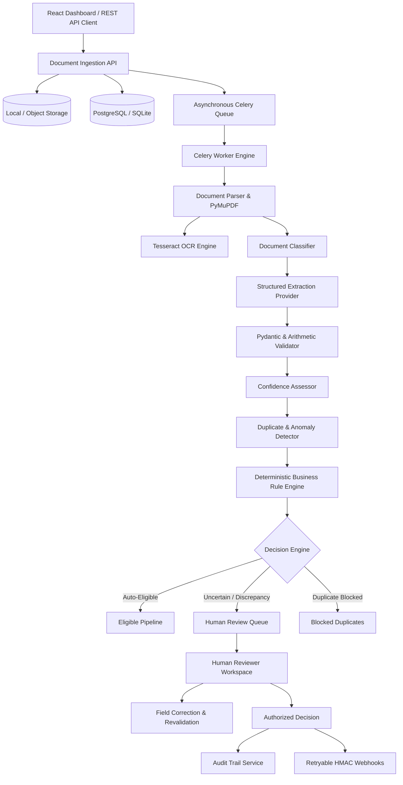

# System Architecture

## Overview

The AI Document Processing & Decision Engine is an enterprise-grade document operations platform designed to convert unstructured vendor documents (invoices, receipts, purchase orders) into validated, structured data and deterministic business decisions.

## Core Architectural Principles

1. **Separation of Extraction and Decision Logic**:
   AI and OCR extract data; deterministic Python services validate arithmetic and business rules; explicit policies determine routing; humans handle uncertainty and exceptions.

2. **Immutable Extraction History**:
   Model extractions are stored as immutable `ExtractionResult` records. Reviewer corrections create sequential `ReviewRecord` revisions without overwriting historical extractions.

3. **Asynchronous & Idempotent Processing**:
   Uploads respond immediately with HTTP 202 Accepted. Processing runs in background Celery workers with transaction-safe state transitions.

4. **Auditability**:
   Every state change, reviewer edit, duplicate flag, and webhook delivery attempt is recorded in the `audit_events` ledger.
